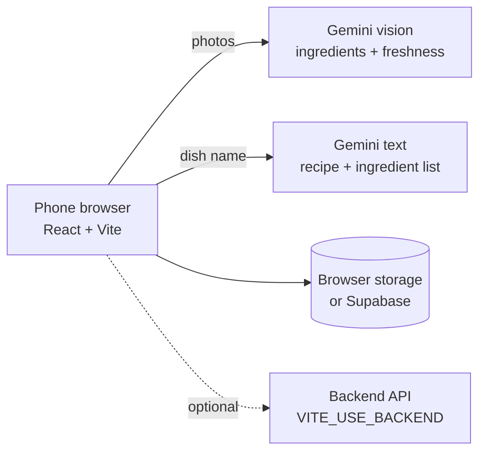

# KitchenFlow

**A mobile-first AI kitchen assistant for home cooks.** Photograph your fridge, and KitchenFlow identifies the ingredients and how fresh they are, works out what you need for the dish you want to cook, and turns the missing ingredients into a shopping list.

KitchenFlow was first prototyped as a native mobile app; this repository is the web version, built mobile-first for the phone browser.

<!-- Add screenshots here: home, scan results grouped by freshness, craving analysis, shopping list -->

## What it does

| Screen | Capability |
|---|---|
| **Scan** | Upload 1–5 photos of a fridge, freezer or pantry; Gemini vision identifies each ingredient and estimates its freshness |
| **Scan results** | Ingredients grouped by freshness, with one tap to save to inventory or add to the shopping list |
| **Cravings** | Type a dish; AI breaks it into ingredients and a recipe, and the missing ingredients go to the shopping list in one tap |
| **Shopping list** | Add, edit, tick off and clear items; store preference and shopping-route view |
| **Inventory** | Filter by fridge / freezer / pantry and remove used items |

## Architecture



The app runs standalone (Gemini + browser storage) or against a backend API when `VITE_USE_BACKEND=true`, so the same frontend works as a quick demo or a full deployment.

## Tech stack

React · TypeScript · Vite · Tailwind CSS · React Router · Google Gemini (`@google/genai`) · Supabase · Vercel

## Run locally

Requirements: Node.js 18+

```bash
cp .env.example .env    # add VITE_GEMINI_API_KEY and Supabase values
npm install
npm run dev
```

Build for static hosting:

```bash
npm run build           # output in dist/
```

> **Note:** in standalone mode the Gemini key is used from the browser, which is fine for a personal demo. For a public deployment, set `VITE_USE_BACKEND=true` so AI calls go through the backend and the key stays server-side.

## Author

Designed and built by **Dong Wang**.
